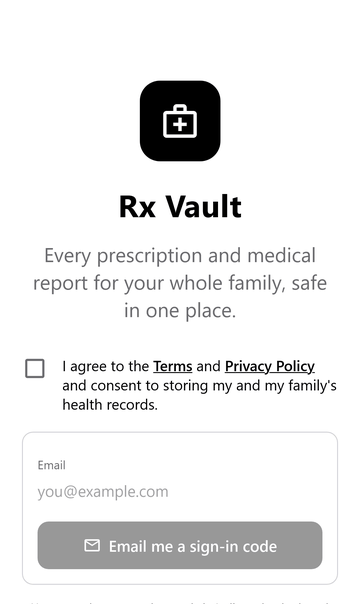
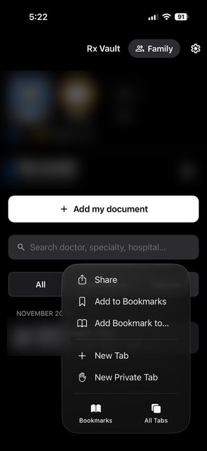
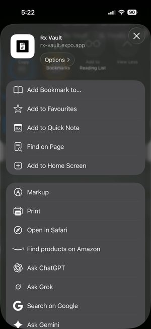
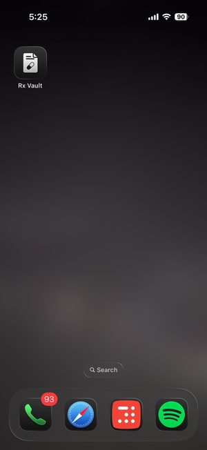
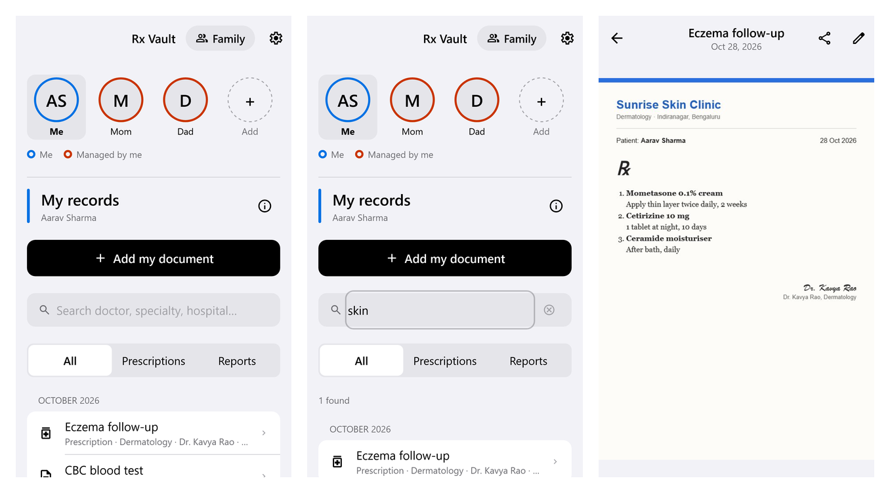
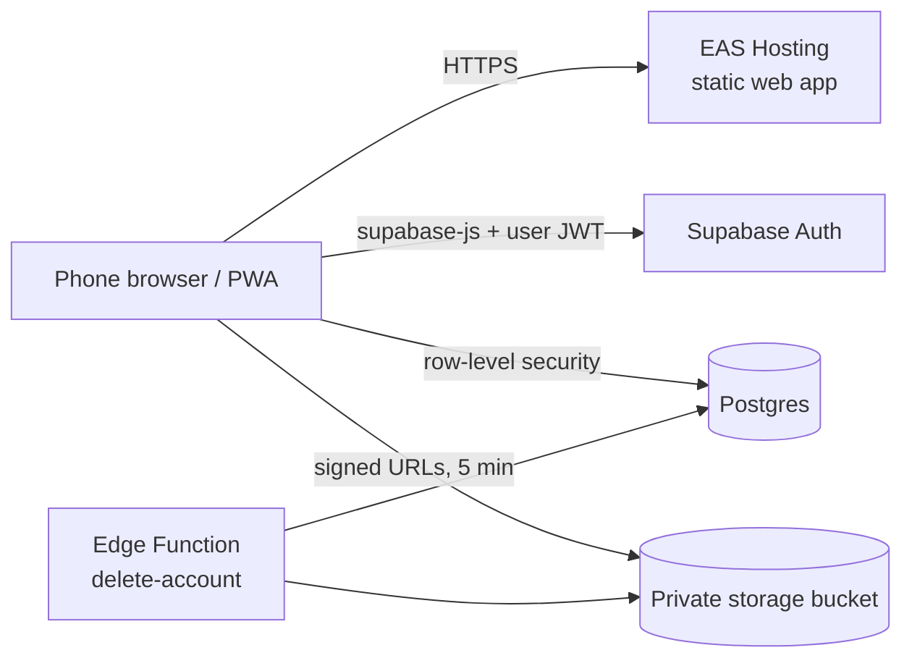

# Rx Vault

**Every prescription and medical report for your whole family, on your phone, findable in seconds.**

**Try it: [rx-vault.expo.app](https://rx-vault.expo.app)** (free beta; open it on your phone and *Add to Home Screen*)

## Why

In most Indian families, prescriptions and lab reports live in a plastic folder, a WhatsApp chat and a parent's handbag. When a doctor asks "what did the last doctor give you?", nobody can find it. Rx Vault keeps them in one place for you, your parents and your children.

- **Snap or import**: camera, photos (multi-page) or PDF.
- **Find in seconds**: search by doctor, hospital or plain words: "skin" finds Dermatology, "heart" finds Cardiology.
- **Whole family**: manage records for parents or children who don't use the app; they can claim them later.
- **Share safely**: a relative can see your records only after you approve, read-only, and you can revoke it any time.
- **Your data stays yours**: stored in India (Mumbai), delete everything in one tap.

## Install on iPhone

No App Store needed. Open [rx-vault.expo.app](https://rx-vault.expo.app) in Safari, then:

| 1. Tap **⋯** → **Share** | 2. **Add to Home Screen** | 3. Open **Rx Vault** like any app |
|:---:|:---:|:---:|
|  |  |  |

On Android Chrome: menu **⋮** → **Add to Home screen**.

Screenshots use a fictional family and made-up documents.

## How it's built

| | |
|---|---|
| App | Expo SDK 58 · React Native · TypeScript · Expo Router, shipped as a web app / PWA (iOS and Android builds from the same code) |
| Backend | Supabase: Postgres, Auth (email code + Google), Storage, an Edge Function for account deletion; region ap-south-1 |
| Hosting | EAS Hosting |
| CI/CD | GitHub Actions: typecheck, lint, Jest, pgTAP database tests, API tests, Playwright on iPhone WebKit + Android Chrome, preview deploy per PR; merging to `master` applies migrations and deploys |

### Security model

- **No backend server to trust**: the app talks to Postgres directly, and **row-level security on every table and storage object** decides what each user can read or write. A user sees a record only if it is theirs, belongs to someone they manage, or was shared with them by approval.
- **Files are private**: the storage bucket is not public; pages load through signed URLs that expire in minutes.
- **Tested**: pgTAP tests try to read and write other people's data and expect to be refused; they run on every pull request.
- **India's DPDP Act**: explicit consent at sign-up, data in Mumbai, in-app account deletion, grievance contact in the [privacy policy](https://rx-vault.expo.app/privacy.html).

See [CONTRIBUTING.md](CONTRIBUTING.md) to run it locally and [SECURITY.md](SECURITY.md) to report a vulnerability.
